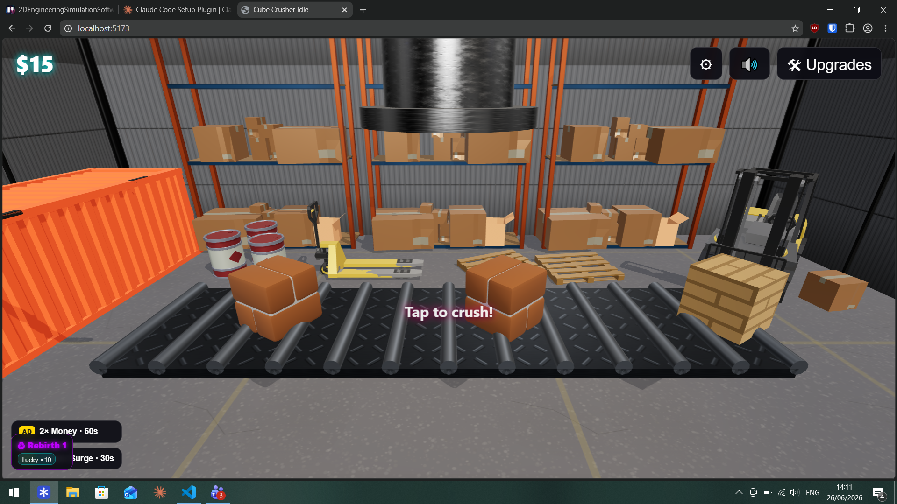

# Cube Crusher Idle

A hypercasual 3D clicker for the browser, built for the [CrazyGames](https://www.crazygames.com/) portal.

Neon cubes ride a conveyor belt toward a hydraulic press. Time your click to slam the press while a cube is in the crush zone: a hit shatters it into particles and pays out, a miss lets it ride off the belt. Spend money on upgrades, beat a boss cube every 30 crushes and rebirth for permanent bonuses.



**Who it's for:** casual players on desktop and mobile browsers.

## Features

- Continuous conveyor with a timing-based crush zone (no auto-play)
- Golden cubes (×10), critical hits (×5) and boss cubes (3 HP, ×25)
- Upgrades: Press Power, Conveyor Speed, Magnet, Golden Cube, Critical Hit
- Rebirth (prestige) with a radial menu of 6 permanent bonuses
- Procedural synthwave music and synthesized sound effects (Web Audio)
- Industrial warehouse scene merged into ~15 draw calls for mobile performance
- CrazyGames SDK: save data, interstitial and rewarded ads, sitelock, with a localStorage fallback

## Built with

- [Three.js](https://threejs.org/) r0.184
- [Vite](https://vitejs.dev/)
- Vanilla JavaScript, HTML and CSS, with no framework

## How to run

Requires Node.js 18+.

```bash
npm install
npm run dev      # local dev server with hot reload
npm run build    # production build into dist/
npm run preview  # serve the production build
```

Outside CrazyGames the SDK calls are skipped and progress is saved to localStorage.

## Project layout

```
src/
  main.js         Entry point, game loop, input, save/load
  gameState.js    Single source of truth for game state
  upgrades.js     Data-driven upgrade definitions and cost formula
  scene.js        Camera, lights, renderer and factory room
  decorations.js  Warehouse props, merged per material
  press.js        Hydraulic press and its animation
  conveyor.js     Belt, cube spawning, crush zone, boss cubes
  cube.js         Cube factory (neon, golden, boss)
  particles.js    Pooled crush particles
  ui.js           DOM overlay: money, upgrades, boss bar, rebirth
  rebirth.js      Prestige system
  audio.js        Sound effects and procedural music
  sdk.js          CrazyGames SDK wrapper
public/           3D models and textures
GDD.md            Original game design document
```

## Roadmap

See [ROADMAP.md](ROADMAP.md).

## License

Code is released under the [MIT License](LICENSE). 3D models and textures in `public/` are third-party assets and keep their own licenses.
